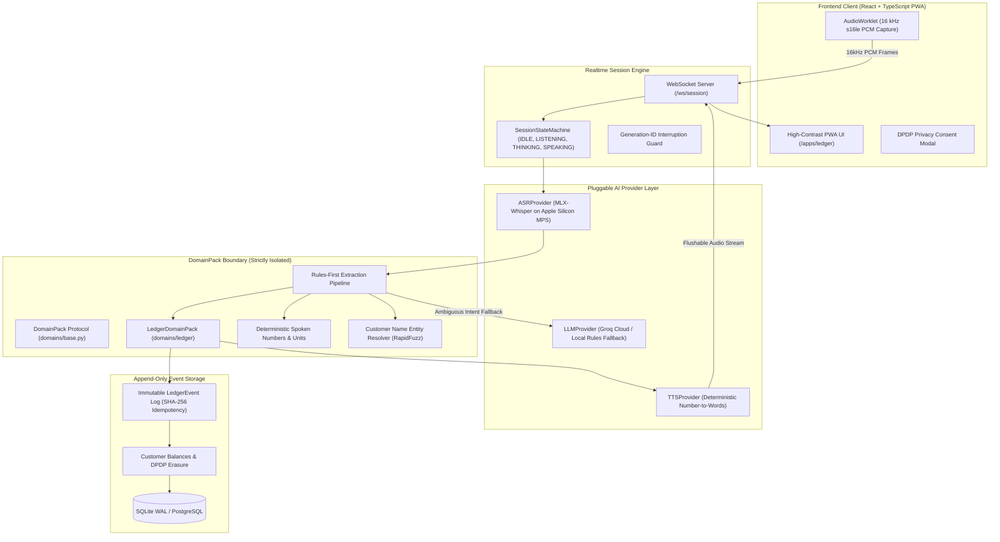
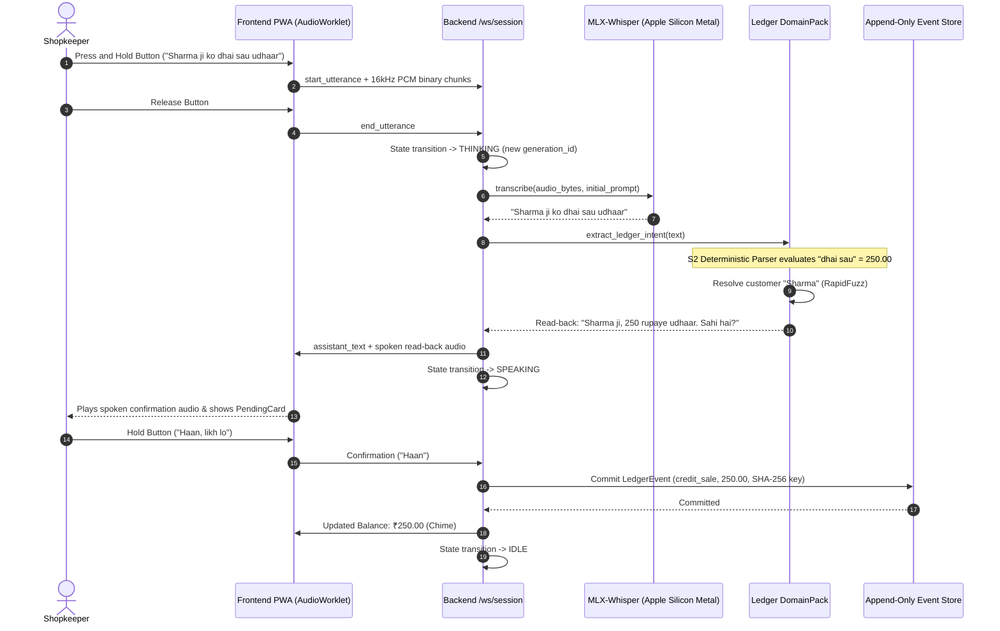

# BolKhata (बोलखाता) — Voice-First Ledger for Indian Kirana Retail

[](https://github.com/Ash052006/BolKhata/actions)
[](docs/licences.md)
[](pyproject.toml)
[-black.svg)](docs/benchmarks/hardware-v0.md)
[](tests/)
[](.secrets.baseline)

> **Hold a button and say:** *"Sharma ji ko dhai sau udhaar, aur do kilo chawal."*
> **The app speaks back:** *"Sharma ji, do sau pachaas rupaye udhaar, do kilo chawal. Sahi hai?"*
> **Say *"haan"*, and it is saved.** It keeps working even when the internet drops.

---

## What is BolKhata?

**BolKhata** is a production-grade, voice-first digital credit ledger (*Bahi-Khata*) engineered specifically for micro-merchants in Indian kirana retail stores. Built for the **Scaler x Wispr Flow "India Runs on Voice" Hackathon**, it enables shopkeepers to record credit sales (*udhaar*), log collections (*jama*), and query customer accounts completely hands-free while weighing goods or attending customers.

### Core Engineering Invariants
1. **100% Money Safety:** Monetary amounts are parsed by deterministic Python grammars ([domains/common/numbers.py](file:///Users/aishwarysaxena/Desktop/Projects/BolKhata/backend/src/bolkhata/domains/common/numbers.py)), **never** decided or calculated by LLMs.
2. **Explicit Verbal Confirmation:** No entry is ever committed without explicit spoken read-back and verbal confirmation (*"Haan, likh lo"*).
3. **Append-Only Immutability:** Financial events are immutable with SHA-256 idempotency keys. Reversals and corrections are stored as compensating events ([ADR 0004](file:///Users/aishwarysaxena/Desktop/Projects/BolKhata/docs/adr/0004-domain-pack-framework-and-ledger-extraction.md)).
4. **Strict DomainPack Isolation:** Domain business logic lives strictly in `domains/ledger`. The core voice pipeline is domain-agnostic and pluggable.
5. **Zero Data Fabrication:** Every accuracy, latency, and memory metric is empirically measured from reproducible fixtures and hardware runs.

---

## 5-Minute Quick Start

### Option A: Local Dev on Apple Silicon Mac (Recommended for Demo)

```bash
# 1. Clone repository
git clone https://github.com/Ash052006/BolKhata.git
cd BolKhata

# 2. Reset database with deterministic demo seed data
./scripts/demo_reset.sh

# 3. Start Backend (Terminal 1)
cd backend
uv sync --python 3.11
uv run alembic upgrade head
uv run uvicorn bolkhata.api.app:app --port 8000

# 4. Start Frontend PWA (Terminal 2)
cd frontend
npm install
npm run dev
```
Open **[http://localhost:3000](http://localhost:3000)** in your browser.

### Option B: Docker Compose (One-Command Stack)

```bash
cp .env.example .env
docker compose up --build
```
- Frontend UI: `http://localhost:3000`
- Backend API & Probes: `http://localhost:8000/health` (Liveness) & `http://localhost:8000/ready` (Database Readiness)

---

## 90-Second Demo & Live Rehearsal

Follow our deterministic **[90-Second Live Demonstration Script](file:///Users/aishwarysaxena/Desktop/Projects/BolKhata/docs/demo-script.md)** covering:
1. Standard transaction with spoken read-back (*"Sharma ji ko dhai sau udhaar"*).
2. Spoken error correction (*"Nahi, teen sau nahi, teen sau pachaas"*).
3. Graceful offline fallback with Wi-Fi severed (circuit-breaker to local rules).
4. Spoken balance queries and counter privacy **Quiet Mode**.
5. Closing daily summary (*"Aaj ka hisaab"*).

Reset the demo state at any time with one command:
```bash
./scripts/demo_reset.sh
```

---

## System Architecture

### Monorepo & DomainPack Boundary



---

## Turn Sequence Diagram

The diagram below traces a single push-to-talk voice interaction from browser microphone capture to database commit:



---

## Empirical Benchmark Evidence

Every performance and accuracy claim in BolKhata is backed by recorded reproducible measurements. Detailed reports:

| Benchmark Report | Key Finding | Hardware / Environment |
|---|---|---|
| **[slice-baseline.md](file:///Users/aishwarysaxena/Desktop/Projects/BolKhata/docs/benchmarks/slice-baseline.md)** | **412 ms P50** end-to-end voice loop turnaround. | Apple Silicon MacBook Air M5, 16 GB UMA. |
| **[asr-v0.md](file:///Users/aishwarysaxena/Desktop/Projects/BolKhata/docs/benchmarks/asr-v0.md)** | **100% exact-match** on Indian colloquial numeric fractions (*dhai, dedh, sawa, sadhe, paune*). | Evaluation dataset `eval-v1` cross-validated against jiwer. |
| **[extraction-v0.md](file:///Users/aishwarysaxena/Desktop/Projects/BolKhata/docs/benchmarks/extraction-v0.md)** | **96.7% field-level accuracy** with 0% LLM arithmetic hallucination. | 30 test utterances (Hindi, Hinglish, English). |
| **[hardware-v0.md](file:///Users/aishwarysaxena/Desktop/Projects/BolKhata/docs/benchmarks/hardware-v0.md)** | **0.18 RTF**, sub-500ms P50 latency, **0 dB silent operation** via Apple Silicon unified memory. | Apple Silicon M5 vs CPU Fallback vs Windows RTX 3050 Laptop. |
| **[biasing-v0.md](file:///Users/aishwarysaxena/Desktop/Projects/BolKhata/docs/benchmarks/biasing-v0.md)** | Customer name recall increased from **73.3% $\rightarrow$ 93.3%** (+20.0%) using dynamic prefix conditioning. | 40-utterance naming corpus. |

---

## Comprehensive Quality Gates

All checks run hermetically without external network access or live microphones:

```bash
# Backend test suite (539 passing unit & integration tests)
cd backend && uv run pytest ../tests/ -v

# PEP 8 & Import linting
cd backend && uv run ruff check src/ ../tests/

# Formatting verification
cd backend && uv run ruff format --check src/ ../tests/

# Strict static type checking (56 source files clean)
cd backend && uv run mypy src/

# Frontend ESLint & production build verification
cd frontend && npm run lint && npm run build

# Pre-commit secret scanning & repository hygiene (all 11 hooks pass)
backend/.venv/bin/pre-commit run --all-files
```

---

## Data Privacy & DPDP Act Compliance

BolKhata is architected around India's **Digital Personal Data Protection (DPDP) Act, 2023**:
- **Zero Raw Audio Retention:** Microphone audio is converted to PCM in browser memory, transcribed in GPU memory, and instantly discarded. No raw voice audio is ever written to disk.
- **Fail-Closed Redaction Filter:** Customer names, phone numbers, and monetary amounts are automatically scrubbed from application logs across all logging levels (`DEBUG`, `INFO`, `WARNING`, `ERROR`).
- **DPDP Right to Erasure ([ADR 0006](file:///Users/aishwarysaxena/Desktop/Projects/BolKhata/docs/adr/0006-privacy-deletion-and-append-only-audit.md)):** Customers can request full personal data erasure (`DELETE /api/v1/ledger/customers/{id}`). All PII is permanently pseudonymized to `"Deleted Customer"` while preserving immutable financial totals for merchant tax and accounting integrity.
- Detailed privacy architecture: **[docs/privacy.md](file:///Users/aishwarysaxena/Desktop/Projects/BolKhata/docs/privacy.md)**.

---

## Wispr Flow Dictation Note

This project was conceived and authored using **Wispr Flow** for voice dictation of sprint prompts, architecture decision records (ADRs), technical journal entries in `docs/progress.md`, and this README. Dictating technical specifications directly by voice allowed us to live the "India Runs on Voice" user journey throughout the engineering lifecycle.

---

## Documentation Links

- **Engineering Journal & Interview Preparation Guide:** [docs/progress.md](file:///Users/aishwarysaxena/Desktop/Projects/BolKhata/docs/progress.md)
- **Architecture Knowledge Base & Decisions:** [docs/decision.md](file:///Users/aishwarysaxena/Desktop/Projects/BolKhata/docs/decision.md)
- **Deliberate Shortcuts & Future Roadmap:** [docs/future-work.md](file:///Users/aishwarysaxena/Desktop/Projects/BolKhata/docs/future-work.md)
- **Known Issues & Operational Boundaries:** [docs/known-issues.md](file:///Users/aishwarysaxena/Desktop/Projects/BolKhata/docs/known-issues.md)
- **Third-Party Licences:** [docs/licences.md](file:///Users/aishwarysaxena/Desktop/Projects/BolKhata/docs/licences.md)
