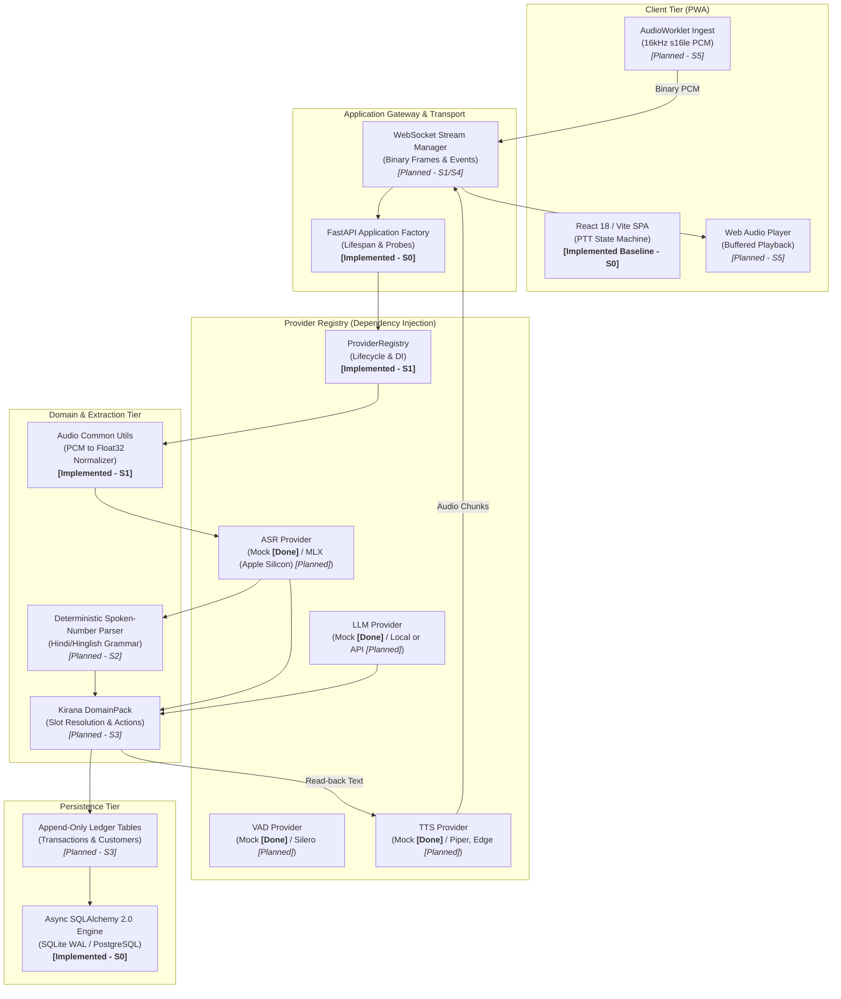
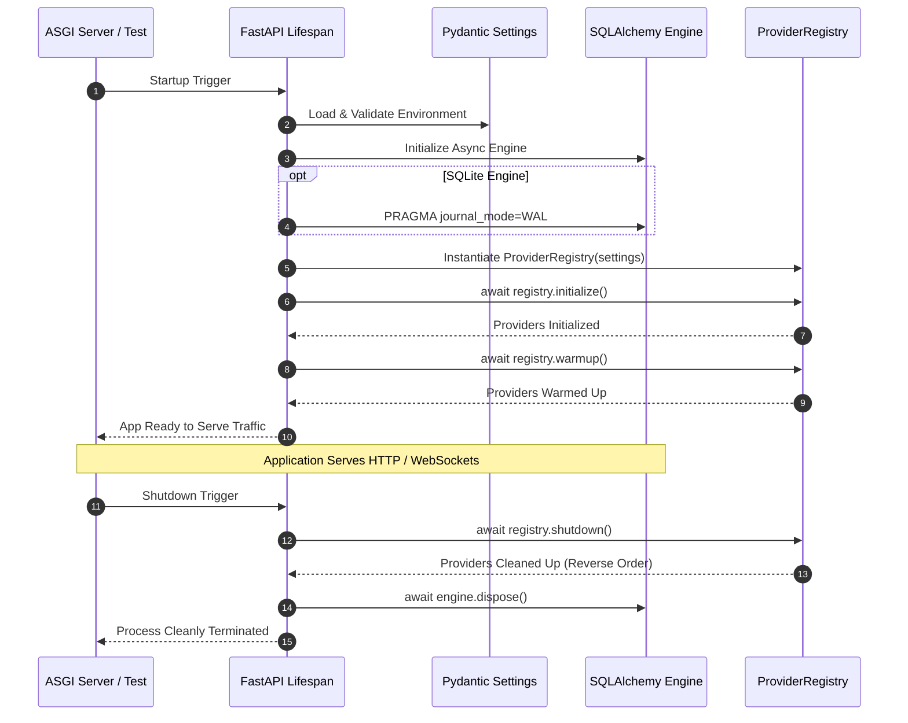
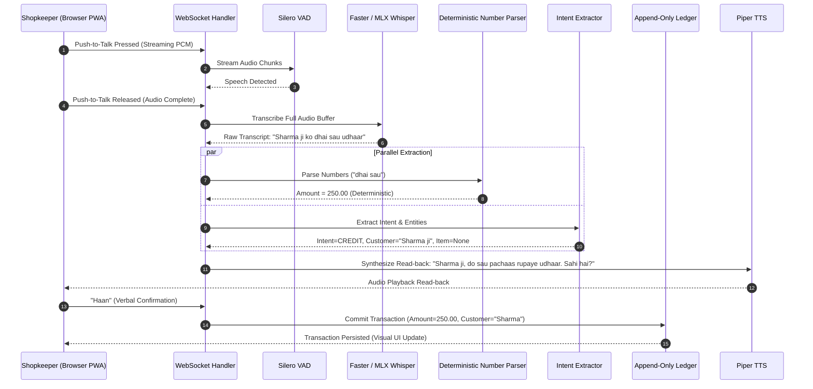

# BolKhata — Architecture Deep Dive & Engineering Internals

> **Document Type:** Comprehensive Technical Architecture & Internal Mechanics Reference
> **Repository:** [https://github.com/Ash052006/BolKhata](https://github.com/Ash052006/BolKhata)
> **Active Branch:** `feat/s1-provider-foundation`
> **Current Version:** Sprint S1 Stage 2

---

## Document Taxonomy & Section Status

To ensure complete engineering transparency, every section in this deep dive is explicitly labeled with its implementation status:
- `[IMPLEMENTED]`: Code is written, tested, passing all CI gates, and verified in Git.
- `[PARTIALLY IMPLEMENTED]`: Core interfaces, mocks, and contracts are merged; concrete production engines or full pipeline connections are in progress.
- `[PLANNED]`: Architectural consensus exists, but no implementation code has been written yet.

---

## Table of Contents

- [1. System Overview `[PARTIALLY IMPLEMENTED]`](#1-system-overview-partially-implemented)
- [2. Monorepo Architecture & Package Layout `[IMPLEMENTED]`](#2-monorepo-architecture--package-layout-implemented)
- [3. Backend Lifecycle & Startup/Shutdown Mechanics `[IMPLEMENTED]`](#3-backend-lifecycle--startupshutdown-mechanics-implemented)
- [4. Provider Architecture & Typed Contracts `[IMPLEMENTED]`](#4-provider-architecture--typed-contracts-implemented)
- [5. Provider Registry Internals & Lifecycle State Machine `[IMPLEMENTED]`](#5-provider-registry-internals--lifecycle-state-machine-implemented)
- [6. Audio Processing Internals & Float32 Normalization `[IMPLEMENTED]`](#6-audio-processing-internals--float32-normalization-implemented)
- [7. End-to-End AI & Speech Pipeline `[PLANNED]`](#7-end-to-end-ai--speech-pipeline-planned)
- [8. DomainPack & Kirana Ledger Architecture `[PLANNED]`](#8-domainpack--kirana-ledger-architecture-planned)
- [9. Reliability, Fault Tolerance & Failure Matrix `[PARTIALLY IMPLEMENTED]`](#9-reliability-fault-tolerance--failure-matrix-partially-implemented)
- [10. Security, Privacy & PII Scrubbing Architecture `[IMPLEMENTED]`](#10-security-privacy--pii-scrubbing-architecture-implemented)
- [11. Testing Architecture & Quality Gates `[IMPLEMENTED]`](#11-testing-architecture--quality-gates-implemented)
- [12. Performance, Concurrency & Profiling Targets `[PARTIALLY IMPLEMENTED]`](#12-performance-concurrency--profiling-targets-partially-implemented)
- [13. Engineering Lessons & Root-Cause Bug Analyses `[IMPLEMENTED]`](#13-engineering-lessons--root-cause-bug-analyses-implemented)
- [14. Future Architecture & Milestone Dependencies `[PLANNED]`](#14-future-architecture--milestone-dependencies-planned)

---

## 1. System Overview `[PARTIALLY IMPLEMENTED]`

### Problem Statement & Domain Context
In India's retail ecosystem, over 12 million micro-merchants (*kirana* grocery stores, vegetable vendors, dairy stalls) rely on daily customer credit (*udhaar*). Traditional paper ledgers (*Bahi-Khata*) are error-prone, easily lost, and require manual bookkeeping after exhaustion from 14-hour work shifts. Existing digital apps demand intensive touch-screen typing, which shopkeepers cannot do while weighing goods, handling cash, or attending queues.

### Target User Persona
- **User:** Traditional kirana store owner.
- **Language Profile:** Multilingual code-switching between Hindi, Indian English, and colloquial Hinglish (*"Sharma ji ko dhai sau udhaar, do kilo chawal"*).
- **Physical Environment:** High ambient acoustic noise (traffic horns, ceiling fans, customer chatter), intermittent 3G/4G connectivity, low-cost Android phones or desktop browser terminals.

### Core Functional & Non-Functional Requirements
- **FR1 (Voice Push-to-Talk):** Stream voice directly to the backend with instantaneous transcription.
- **FR2 (Deterministic Number Resolution):** Spoken amounts (*dhai sau*, *dedh hazaar*) must be parsed mathematically, never guessed.
- **FR3 (Explicit Verbal Read-Back):** Every financial transaction must be synthesized and spoken back (*"Sharma ji, 250 rupaye udhaar. Sahi hai?"*) before commitment.
- **FR4 (Append-Only Persistence):** Immutable transaction ledgers with full compensating audit trails.
- **NFR1 (Zero Test Network Dependency):** CI and local dev must run 100% offline without downloading multi-gigabyte models.
- **NFR2 (Apple Silicon-Only Local Inference):** Native hardware execution planned exclusively for Apple Silicon (Metal/MLX); mock providers remain platform-independent for hermetic cross-platform CI testing. *(Historical note: initial dual-platform NVIDIA/CTranslate2 planning was superseded per DEC-0026).*
- **NFR3 (Fail-Closed Privacy):** Zero customer PII or financial amounts leaked in server logs.

### Component Architecture Diagram



---

## 2. Monorepo Architecture & Package Layout `[IMPLEMENTED]`

The repository is structured as a unified monorepo cleanly isolating backend services, frontend assets, test suites, and documentation.

```text
BolKhata/
├── backend/
│   ├── alembic/                # Async database migrations
│   │   ├── env.py              # Async migration runner (SQLAlchemy + aiosqlite/asyncpg)
│   │   └── script.py.mako      # Migration file template
│   ├── src/
│   │   └── bolkhata/
│   │       ├── api/            # HTTP routers and application factory
│   │       │   ├── app.py      # create_app factory and lifespan context
│   │       │   └── routes/     # Endpoint definitions (health, ready)
│   │       ├── asr/            # Speech recognition contracts and adapters
│   │       │   ├── base.py     # Abstract ASRProvider, ASRResult dataclass
│   │       │   ├── common.py   # PCM normalization and audio math utilities
│   │       │   ├── mock.py     # Deterministic MockASRProvider
│   │       │   └── vad.py      # Abstract VADProvider and MockVADProvider
│   │       ├── common/         # Cross-cutting foundational utilities
│   │       │   ├── db.py       # Async SQLAlchemy engine and sessionmaker
│   │       │   ├── logging.py  # Structured JSON log formatter with PII redaction
│   │       │   └── registry.py # ProviderRegistry dependency injection engine
│   │       ├── config/         # Strongly typed application configuration
│   │       │   └── settings.py # Pydantic v2 BaseSettings with field validators
│   │       ├── domains/        # Pluggable business domain boundaries
│   │       │   └── __init__.py # Boundary marker (code outside cannot import domains)
│   │       ├── llm/            # Language model reasoning contracts and mocks
│   │       │   ├── base.py     # Abstract LLMProvider, ChatMessage, LLMResponse
│   │       │   └── mock.py     # Deterministic MockLLMProvider with fixture store
│   │       └── tts/            # Text-to-speech synthesis contracts and mocks
│   │           ├── base.py     # Abstract TTSProvider
│   │           └── mock.py     # Deterministic MockTTSProvider (sine PCM generator)
│   └── pyproject.toml          # Backend dependencies, Mypy/Ruff/pytest configuration
├── frontend/                   # React 18, TypeScript, Vite 6 PWA
│   ├── src/
│   │   ├── apps/ledger/        # Frontend ledger domain view boundary
│   │   ├── App.tsx             # Root React view with health monitoring
│   │   └── main.tsx            # React DOM mounting
│   ├── package.json            # Node dependencies and scripts
│   └── tsconfig.json           # Strict TypeScript configuration
├── tests/                      # Unified automated test suites
│   ├── conftest.py             # Global pytest fixtures (DB session, mock registry)
│   ├── integration/            # Multi-component and database integration tests
│   │   ├── test_alembic_smoke.py # Complete migration upgrade/downgrade verification
│   │   ├── test_health.py      # /health liveness endpoint tests
│   │   ├── test_lifespan.py    # Startup/shutdown lifecycle and SQLite WAL verification
│   │   └── test_ready.py       # /ready probe under healthy and failing DB states
│   └── unit/                   # Hermetic, zero-IO unit tests
│       ├── test_asr_common.py  # PCM-to-float32 and duration calculation tests
│       ├── test_logging_redaction.py # PII and credential scrubbing verification
│       └── test_providers_mock.py    # Provider contracts, lifecycle rollbacks, retries
├── docs/                       # Architecture, decisions, and interview knowledge base
│   ├── adr/                    # Architecture Decision Records (0001, 0002, 0003)
│   ├── architecture-deep-dive.md # This comprehensive internals document
│   ├── decision.md             # Chronological engineering decision log
│   ├── interview-guide.md      # Grounded technical interview preparation
│   ├── progress.md             # Living progress tracker and verified Git evidence
│   └── README.md               # Documentation navigation index and source of truth
├── .pre-commit-config.yaml     # 11 automated pre-commit quality gates
├── .secrets.baseline           # Audited detect-secrets allowlist
└── docker-compose.yml          # Single-command containerized local execution
```

---

## 3. Backend Lifecycle & Startup/Shutdown Mechanics `[IMPLEMENTED]`

### Application Factory (`bolkhata.api.app:create_app`)
Rather than using a global module-level application instance, BolKhata uses the factory pattern:
```python
def create_app(settings: Settings | None = None) -> FastAPI:
    if settings is None:
        settings = Settings()
    # Instantiate FastAPI with bound lifespan
    app = FastAPI(
        title="BolKhata",
        lifespan=_lifespan,
    )
    # Register routers and bind settings to app.state
    ...
```

### Lifespan Sequence Flow
The application lifespan coordinates database initialization, PRAGMA setup, and provider lifecycle:



---

## 4. Provider Architecture & Typed Contracts `[IMPLEMENTED]`

All AI capabilities inherit from abstract base classes defined under `bolkhata/{asr,tts,llm}/base.py`. Every provider implements the unified lifecycle interface `BaseProvider`:

```python
class BaseProvider(ABC):
    @abstractmethod
    async def initialize(self) -> None:
        """Allocate resources (load weights, initialize engines, open sessions)."""

    @abstractmethod
    async def warmup(self) -> None:
        """Run a minimal inference pass to warm up caches and GPU kernels."""

    @abstractmethod
    async def shutdown(self) -> None:
        """Release all allocated resources and reset state."""
```

### 1. `ASRProvider` Contract (`bolkhata.asr.base`)
- **Input:** Raw signed 16-bit little-endian mono 16 kHz PCM bytes (`bytes`) or chunked stream (`AsyncIterable[bytes]`), optional `language: str | None`, and optional `initial_prompt: str | None = None` for vocabulary conditioning.
- **Output:** Immutable `ASRResult` dataclass:
  ```python
  @dataclass(frozen=True)
  class WordTiming:
      word: str
      start_ms: float
      end_ms: float
      confidence: float | None = None

  @dataclass(frozen=True)
  class ASRResult:
      text: str
      language: str
      confidence: float | None
      duration_ms: float
      words: tuple[WordTiming, ...] = ()
  ```
- **Invariants:**
  - `confidence` is `float | None`. Numeric values are restricted to documented runtime probabilities; uncalibrated scores or missing probabilities are represented strictly as `None`.
  - Empty audio input returns an empty result: `ASRResult(text="", language=..., confidence=None, duration_ms=0.0, words=())`.
  - `words` is deeply immutable (`tuple[WordTiming, ...]`), preventing accidental in-place mutation by downstream pipeline filters.
  - `initial_prompt` supplies textual context tokens to Whisper's autoregressive decoder. It can bias recognition toward domain vocabulary (*Sharma ji, udhaar, jama, chawal*), but does not guarantee correct recognition and cannot replace acoustic evidence. Excessive or incorrect prompt context can bias the transcript incorrectly or increase hallucination risk. Operational efficacy must be evaluated on real audio using both positive and negative controls.
- **Hardware Target & Real Engine Architecture `[PLANNED]`:**
  - Real ASR execution is planned exclusively for the **Apple Silicon MacBook Air M5** (16 GB unified memory) using Apple's MLX machine learning framework (`mlx-whisper`).
  - Unified memory architecture allows the CPU and Metal GPU to access model weights directly in unified RAM without PCIe host-to-device bus transfer overhead. (MLX execution operates across CPU and Metal GPU cores; claims of Neural Engine / ANE utilization are unproven and excluded).
  - Model memory footprint, latency budget compliance, and Word Error Rate (WER) remain **unmeasured** until the real MLX adapter is implemented and benchmarked on target hardware.
  - Windows/NVIDIA/CUDA and Faster-Whisper configurations were superseded and completely removed (see [DEC-0026](decision.md#dec-0026-apple-silicon-only-architecture-with-mlx-asr-runtime)).
  - Real MLX neural inference is scheduled for Stage 2; base package load and CI remain 100% offline and platform-independent using deterministic mocks (`MockASRProvider` is currently the only active ASR engine).

### 2. `TTSProvider` Contract (`bolkhata.tts.base`)
- **Input:** Plain text string (`str`), voice ID (`str | None`), speaking rate multiplier (`float`).
- **Output:** `synthesize` returns complete raw PCM bytes (`bytes`); `stream_synthesize` yields an `AsyncIterator[bytes]`.
- **Mock Behavior:** `MockTTSProvider` generates mathematically continuous sine-wave PCM audio matching the exact duration required by the character length of the input text, allowing downstream audio pipelines to receive valid PCM buffers.

### 3. `LLMProvider` Contract (`bolkhata.llm.base`)
- **Input:** Sequence of `ChatMessage` objects (`role: str`, `content: str`).
- **Output:**
  - `stream_chat`: `AsyncIterator[str]` emitting text tokens.
  - `complete_structured`: Parses response into a strongly typed Pydantic `BaseModel` instance:
    ```python
    async def complete_structured(
        self,
        messages: Sequence[ChatMessage],
        response_model: type[T],
        temperature: float = 0.0,
    ) -> T: ...
    ```
- **Invariants:** In `MockLLMProvider`, arbitrary schema synthesis is forbidden. If a caller requests a structured model without registering an explicit fixture, it raises `ValueError` immediately (fail-closed for money safety).

### 4. `VADProvider` Contract (`bolkhata.asr.vad`)
- **Input:** 16 kHz PCM audio chunks.
- **Output:** Boolean speech activity probability flag or segmented speech timestamps.

---

## 5. Provider Registry Internals & Lifecycle State Machine `[IMPLEMENTED]`

The `ProviderRegistry` (`bolkhata.common.registry`) acts as the dependency-injected orchestration brain for all AI models.

### Concurrency & Thread Safety
All state transitions are protected by an internal `asyncio.Lock()`. Multiple concurrent calls to `initialize()` or `shutdown()` are serialized safely.

### Canonical Startup Ordering
Providers are instantiated and initialized in a strict canonical dependency sequence:
$$\text{ASR} \longrightarrow \text{TTS} \longrightarrow \text{LLM} \longrightarrow \text{VAD (Optional)}$$

### Reverse-Order Teardown Invariant
During application shutdown or startup rollback, providers are shut down in the exact reverse sequence:
$$\text{VAD (Optional)} \longrightarrow \text{LLM} \longrightarrow \text{TTS} \longrightarrow \text{ASR}$$

### Identity-Based Tracking & Retry Ordering
- Initialized providers are tracked in a single ordered list: `_initialized_providers: list[BaseProvider]`.
- Providers are appended immediately after their `initialize()` method succeeds.
- When `shutdown()` executes, it iterates over `reversed(self._initialized_providers)`.
- **Successful Cleanup:** The provider is removed from `_initialized_providers`.
- **Failed Cleanup:** If a provider's `shutdown()` raises an exception, the provider **remains in `_initialized_providers`**.
- **Retry Invariant:** Because the list retains surviving failed providers in their original relative positions, any subsequent retry of `shutdown()` will again iterate in `reversed()` order, preserving the strict reverse-startup sequence.

### Registry State Diagram

```mermaid
stateDiagram-v2
    [*] --> Uninitialized

    Uninitialized --> Initializing: initialize() [Acquires Lock]
    Initializing --> Initialized: All providers initialize() succeed
    Initializing --> RollingBack: Any initialize() or warmup() fails

    RollingBack --> Uninitialized: Reverse cleanup succeeds; re-raise original error
    RollingBack --> PartiallyFailed: Cleanup error occurs during rollback; re-raise

    Initialized --> WarmingUp: warmup() [Acquires Lock]
    WarmingUp --> Ready: All providers warmup() succeed
    WarmingUp --> RollingBack: Warmup fails (triggers full reverse rollback)

    Ready --> ShuttingDown: shutdown() [Acquires Lock]
    ShuttingDown --> Uninitialized: All reverse shutdown() succeed
    ShuttingDown --> ShutdownFailed: One or more provider shutdown() fail

    ShutdownFailed --> ShuttingDown: shutdown() retry (preserves reverse order)
```

---

## 6. Audio Processing Internals & Float32 Normalization `[IMPLEMENTED]`

BolKhata implements zero-dependency audio processing utilities in `bolkhata.asr.common`.

### The Binary PCM Contract
- **Sample Rate:** $16,000 \text{ Hz}$ (`SAMPLE_RATE_HZ`)
- **Channels:** $1$ Mono (`CHANNELS`)
- **Sample Format:** Signed 16-bit Linear PCM Little-Endian (`BYTES_PER_SAMPLE = 2`)
- **Data Throughput:** Exactly $16,000 \times 2 = 32,000 \text{ bytes/sec}$ ($32 \text{ KB/s}$).

### Float32 Mathematical Normalization
Neural ASR encoders require floating-point tensors normalized to $[-1.0, 1.0]$. The conversion formula implemented in `pcm_to_float32` divides signed 16-bit integers by $32768.0$:

$$\text{sample}_{\text{float32}} = \frac{\text{sample}_{\text{int16}}}{32768.0}$$

#### Boundary Mappings:
| Signed 16-bit Hex / Value | Float32 Output | Verification |
|---|---|---|
| `0x8000` ($-32,768$) | $-1.000000$ | Exactly $-1.0$ (Minimum boundary) |
| `0x0000` ($0$) | $0.000000$ | Zero center |
| `0x7FFF` ($+32,767$) | $+0.999969$ | $32767 / 32768.0$ (Strictly $< 1.0$) |

### Endianness & Buffer Protocol Safety
On big-endian systems, `pcm_to_float32` automatically calls `raw_samples.byteswap()`:
```python
raw_samples = array.array("h")
raw_samples.frombytes(audio_bytes)
if sys.byteorder != "little":
    raw_samples.byteswap()
return array.array("f", (s / 32768.0 for s in raw_samples))
```

### Strict Buffer Validation
- Odd-length byte buffers (`len(audio_bytes) % 2 != 0`) violate the 16-bit boundary and immediately raise `AudioFormatError`.
- Empty byte inputs return an empty `array.array("f")`.
- `compute_duration_ms` calculates duration: $\frac{\text{byte\_count}}{\text{sample\_rate} \times \text{bytes\_per\_sample}} \times 1000.0$. Negative bytes or misaligned buffers are rejected immediately.

---

## 7. End-to-End AI & Speech Pipeline `[PLANNED]`

The production voice pipeline will connect browser audio streaming directly to the ledger via WebSockets:



---

## 8. DomainPack & Kirana Ledger Architecture `[PLANNED]`

### The Domain Isolation Contract (ADR 0002)
To allow BolKhata to adapt to different retail sectors or hackathon requirements, business logic is isolated in a `DomainPack` protocol:
1. **Schema:** Pydantic models for domain entities (Customer, DebtEntry, ItemSale).
2. **Normalizers:** Domain-specific text cleanup (kirana quantity units: *kilo, packet, pav*).
3. **Entity Resolvers:** Fuzzy matching spoken customer names against local merchant contact books.
4. **Read-Back Templates:** Grammatical phrasing for spoken verification in Hindi/English.
5. **Evaluation Set:** Ground-truth audio and transcript test pairs for accuracy benchmarking.

### Append-Only Ledger Schema Invariants
- No SQL `UPDATE` or `DELETE` on financial records.
- Corrections post a compensating reversal row referencing the original `transaction_id`.
- Unique constraints on `idempotency_key` prevent duplicate entries from network retries.

---

## 9. Reliability, Fault Tolerance & Failure Matrix `[PARTIALLY IMPLEMENTED]`

| Failure Scenario | Component Handling | User Experience / Impact | Implementation Status |
|---|---|---|---|
| **Database Disconnected** | `GET /ready` returns HTTP 503; API raises `DatabaseUnavailableError`. | Voice session halts; merchant is asked to retry; local changes buffered in client IndexedDB. | **Implemented (S0)** |
| **Model Init/Warmup Crash** | `ProviderRegistry` executes automatic reverse rollback of all prior models. | Container fails fast during startup; avoids orphan GPU memory leaks. | **Implemented (S1)** |
| **Provider Teardown Error** | Registry logs error, retains provider identity, and preserves reverse sequence on retry. | Graceful container shutdown during SIGTERM or retry. | **Implemented (S1)** |
| **Odd Audio Byte Frame** | `pcm_to_float32` raises structured `AudioFormatError`. | Frame rejected before polluting ASR buffers with phase-shifted white noise. | **Implemented (S1)** |
| **ASR Inference Timeout** | Async semaphore releases; returns `SpeechRecognitionTimeoutError`. | Merchant prompted: *"Awaaz samajh nahi aayi, kripya dobara bolein."* | *Planned (S1)* |
| **Ambiguous Spoken Amount** | Deterministic parser detects conflicting numbers (*"pachaas ya saatth"*). | LLM generates clarification prompt: *"Kya amount pachaas hai ya saatth?"* | *Planned (S2)* |
| **Network Drop During PTT** | Client WebSocket detects disconnect, buffers PCM locally in memory. | Reconnects automatically; retransmits turn with same `idempotency_key`. | *Planned (S4)* |

---

## 10. Security, Privacy & PII Scrubbing Architecture `[IMPLEMENTED]`

### Fail-Closed Structured Logging (`bolkhata.common.logging`)
Kirana store records contain sensitive personal customer data. `StructuredJsonFormatter` guarantees that unredacted data never leaves process memory:
1. **Key Scrubbing:** Recursively scrubs dictionary keys: `customer_name`, `customer`, `phone`, `phone_number`, `secret`, `password`, `api_key`, `token`, `authorization`, `credit_card`.
2. **Regex Scrubbing:** Scans all string values for Indian mobile numbers (`\b[6-9]\d{9}\b`), JWT tokens, and Bearer headers.
3. **Exception Sanitization:** Sanitizes local variables and formatted tracebacks across nested exception chains (`__cause__` and `__context__`).
4. **Fail-Closed Sentinel:** If an unexpected formatting error occurs inside the logger, it catches the error and emits:
   ```json
   {"timestamp": "...", "level": "ERROR", "message": "[LOGGING_FAILED] Log record could not be formatted safely"}
   ```

### Hermetic Secret Scanning
Tracked repository files are guarded by `detect-secrets`. Synthetic test tokens used in redaction tests are audited and allowlisted strictly at the line level in `.secrets.baseline`.

---

## 11. Testing Architecture & Quality Gates `[IMPLEMENTED]`

BolKhata maintains a multi-layer verification harness:

```text
Quality Gates Pipeline:
1. pytest (96 unit & integration tests across DB, logging, providers, audio)
2. ruff check src/ ../tests/ (Zero lint or style errors)
3. ruff format --check (Zero formatting drift)
4. mypy src/bolkhata (Strict static typing across 23 source files)
5. npm run lint & build (ESLint clean, Vite bundle compiled in <300ms)
6. pre-commit run --all-files (Pass 1: auto-format; Pass 2: idempotency verify)
7. detect-secrets scan (Zero unallowlisted credentials)
8. git diff --check (Zero whitespace or carriage return violations)
```

---

## 12. Performance, Concurrency & Profiling Targets `[PARTIALLY IMPLEMENTED]`

### Latency Budget (Target Hardware: M-Series Mac & RTX 3050)
The following targets are established in `docs/slo.md` and will be measured in S5:
- **PTT-to-first-token:** $\le 300 \text{ ms}$
- **PTT-to-complete-transcript:** $\le 1000 \text{ ms}$ (for 3-second utterances)
- **Deterministic Number Extraction:** $\le 10 \text{ ms}$
- **TTS Time-to-First-Audio-Chunk (TTFB):** $\le 250 \text{ ms}$
- **Total Turnaround Time (Speech-to-Readback):** $\le 1500 \text{ ms}$

### Concurrency Invariants
- `asr_max_concurrency: int = 1` (default): Serializes heavy neural ASR calls via async semaphores, preventing CPU core thrashing on developer laptops.

---

## 13. Engineering Lessons & Root-Cause Bug Analyses `[IMPLEMENTED]`

### Bug 1: Registry Rollback Orphaned Memory
- **Root Cause:** Providers were appended to `_initialized_providers` only after both `initialize()` and `warmup()` passed. If warmup raised an out-of-memory exception, previously initialized state was never torn down.
- **Fix:** Track providers immediately upon successful `initialize()`.
- **Test:** `test_asr_warmup_failure_after_successful_initialization`.
- **Lesson:** Track allocated resources immediately at the point of allocation, not at the end of the entire multi-stage bootstrap pipeline.

### Bug 2: Cancellation Did Not Abort Native Threads
- **Root Cause:** Documentation claimed cancelling an asyncio task halted inference. In reality, `asyncio.to_thread` runs on an OS worker thread that cannot be killed.
- **Fix:** Explicitly documented non-blocking event loop cancellation semantics and bounded worker concurrency via semaphores.
- **Lesson:** Never assume language abstractions can bypass operating system thread mechanics.

### Bug 3: Mock LLM Hallucinated Financial Schemas
- **Root Cause:** Generic fallback in `MockLLMProvider` populated unknown schemas with arbitrary fake values, allowing invalid financial models to pass tests.
- **Fix:** Enforce explicit pre-configured fixtures for structured output; unconfigured schemas raise `ValueError`.
- **Test:** `test_mock_llm_complete_structured_missing_fixture_fails`.
- **Lesson:** In financial domains, test doubles must fail closed rather than hallucinating plausible-looking numbers.

### Bug 4: Cleanup Retry Order Inversion
- **Root Cause:** Providers that failed `shutdown()` were popped from the tracking list and appended to a retry list. If multiple providers failed, their relative order was inverted on subsequent retry calls.
- **Fix:** Replaced popping with identity-based tracking in a canonical startup list. Only successful shutdowns remove providers.
- **Test:** `test_multiple_providers_fail_shutdown_retried_in_reverse_startup_order`.
- **Lesson:** Avoid auxiliary retry lists when sequence invariants must be preserved across repeated failure cycles.

---

## 14. Future Architecture & Milestone Dependencies `[PLANNED]`

```mermaid
graph LR
    S1[S1: Provider Adapters<br/>MLX (Apple Silicon) <i>[Planned]</i>] --> S2[S2: Deterministic Number Parser<br/>& Evaluation Harness]
    S2 --> S3[S3: Kirana DomainPack<br/>& Append-Only Ledger]
    S3 --> S4[S4: Spoken Read-Back<br/>& Verbal Correction Loop]
    S4 --> S5[S5: React PWA AudioWorklet<br/>& Hardware Benchmarks]
    S5 --> S6[S6: Final Freeze<br/>& Evidence Package]
```

Every stage strictly builds on the verified invariants of the preceding sprint, ensuring that no non-deterministic AI feature is introduced without deterministic testing foundations.
